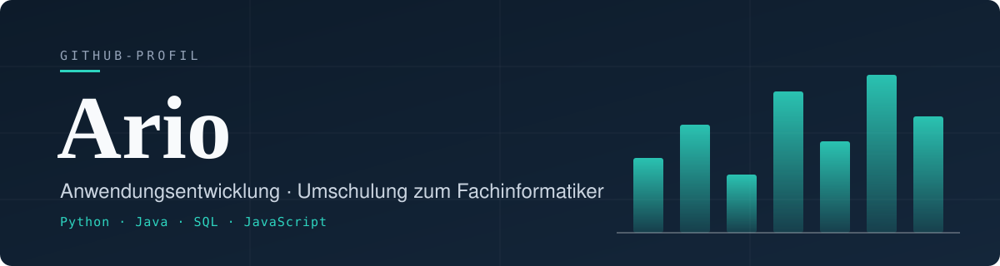

[README.md](https://github.com/user-attachments/files/34957834/README.md)

 

Ich mache bei der CBW eine Umschulung zum Fachinformatiker für Anwendungsentwicklung und lerne, Software so zu schreiben, dass andere sie lesen, testen und weiterentwickeln können.

Hier sammle ich Projekte aus dem Unterricht und aus eigener Übung. Ich bin noch in der Ausbildung, der IHK-Abschluss steht aus.

 

## Projekt

<table>
<tr>
<td width="100%">

### [Ausgaben-Report](https://github.com/Ario-Mi/ausgaben-report)

Ein Python-Kommandozeilenprogramm, das Ausgaben aus einer CSV-Datei einliest und als Monatsübersicht nach Kategorien auswertet.

- Monatsübersicht nach Kategorien, optional gefiltert auf einen einzelnen Monat
- Exakte Geldbeträge durch Rechnen mit `Decimal` statt Fließkommazahlen
- Prüfung der Eingaben mit verständlichen Fehlermeldungen
- Getrennte Bereiche für Einlesen, Auswertung und Ausgabe
- Automatisierte Tests mit `unittest`
- Keine zusätzlichen Python-Pakete erforderlich

[Zum Repository](https://github.com/Ario-Mi/ausgaben-report)

</td>
</tr>
</table>

 

## Zertifizierungen

| Zertifizierung | Aussteller |
| :-- | :-- |
| **Professional Scrum Master I (PSM I)** | Scrum.org |
| **AWS Certified Cloud Practitioner** | Amazon Web Services |
| **Oracle Certified Foundations Associate, Java** | Oracle |

 

## Technologien

| Bereich | Aus Unterricht und Übungsprojekten | Grundlagen |
| :-- | :-- | :-- |
| **Programmiersprachen** | Python, Java, PHP, JavaScript | Node.js |
| **Web** | HTML5, CSS3, React, jQuery, WordPress | |
| **Daten** | SQL, relationale Datenbanken, Datenbankentwurf | NoSQL |
| **Vorgehen und Entwurf** | Objektorientierte Programmierung, UML, Scrum | |

 

<b>Weitere Unterrichtsinhalte</b>

 

Diese Themen habe ich in der Umschulung kennengelernt, zum Teil mit Übungen, überwiegend auf Grundlagenniveau:

| Bereich | Inhalte |
| :-- | :-- |
| **Systeme und Netzwerk** | Hyper-V sowie Grundlagen zu Windows Server, Active Directory, DNS, DHCP und Netzwerken |
| **Cloud** | Grundlagen zu AWS und Microsoft Azure |
| **Weitere Themen** | Grundlagen zu IT-Sicherheit, künstlicher Intelligenz, Machine Learning und Deep Learning |

