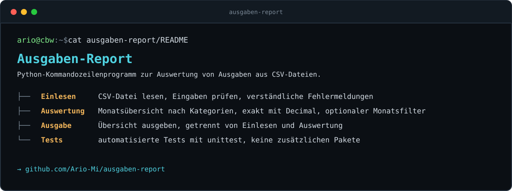
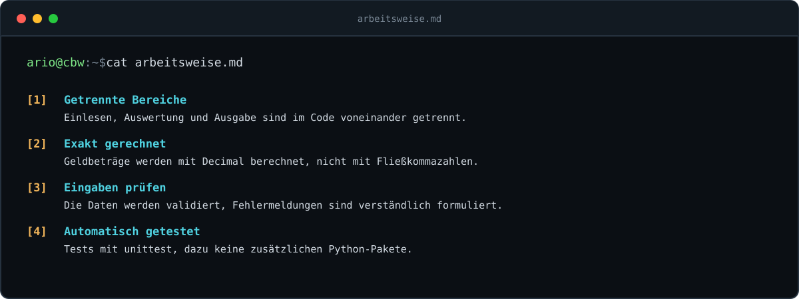

[README.md](https://github.com/user-attachments/files/34964106/README.md)

 

Ich mache bei der CBW eine Umschulung zum Fachinformatiker für Anwendungsentwicklung und lerne, Software so zu schreiben, dass andere sie lesen, testen und weiterentwickeln können. Hier sammle ich Projekte aus dem Unterricht und aus eigener Übung. Ich bin noch in der Ausbildung, der IHK-Abschluss steht aus.

 

 

 

 

<b>Weitere Unterrichtsinhalte</b>

 

Diese Themen habe ich in der Umschulung kennengelernt, überwiegend auf Grundlagenniveau:

| Bereich | Inhalte |
| :-- | :-- |
| **Systeme und Netzwerk** | Hyper-V sowie Grundlagen zu Windows Server, Active Directory, DNS, DHCP und Netzwerken |
| **Cloud** | Grundlagen zu AWS und Microsoft Azure |
| **Weitere Themen** | Grundlagen zu IT-Sicherheit, künstlicher Intelligenz, Machine Learning und Deep Learning |

