


 

Ich mache bei der CBW eine Umschulung zum Fachinformatiker für Anwendungsentwicklung und suche einen Praktikumsplatz in Frankfurt am Main. Mir ist wichtig, dass Software nachvollziehbar bleibt: klare Regeln im Code und in der Datenbank, Tests und keine Zugangsdaten im Repository. Ich bin noch in der Ausbildung, der IHK-Abschluss steht aus.

 

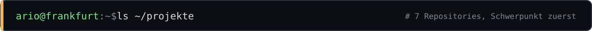

<a href="https://github.com/Ario-Mi/geraeteverleih">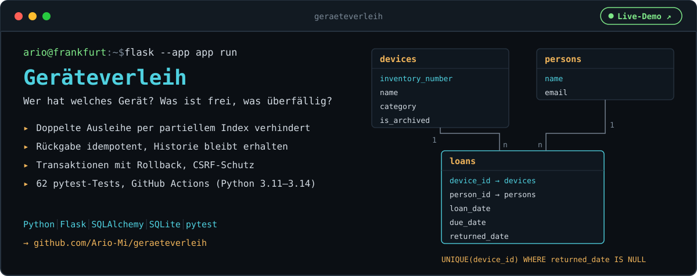</a>

<a href="https://github.com/Ario-Mi/cinescope-php">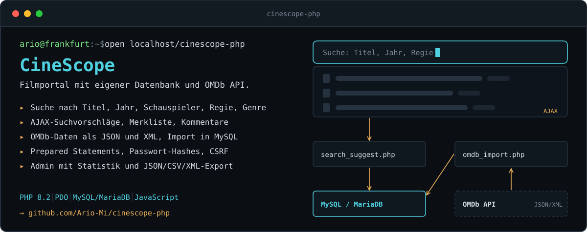</a>

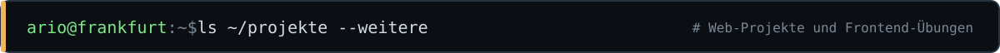

<a href="https://github.com/Ario-Mi/signal-radio-tv"></a>
<a href="https://github.com/Ario-Mi/ausgaben-report"></a>
<a href="https://github.com/Ario-Mi/qr-studio"></a>
<a href="https://github.com/Ario-Mi/circular-navigation"></a>

<b>Live-Demos:</b>
<a href="https://ario-mi.github.io/geraeteverleih/">Geräteverleih</a> ·
<a href="https://ario-mi.github.io/signal-radio-tv/">SIGNAL Studio</a> ·
<a href="https://ario-mi.github.io/qr-studio/">QR Studio</a> ·
<a href="https://ario-mi.github.io/circular-navigation/">Circular Navigation</a>

 

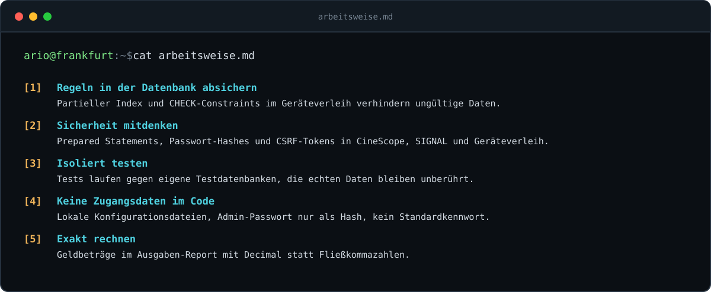

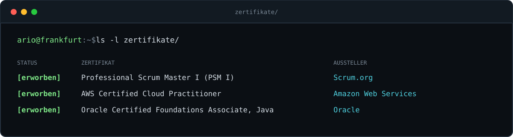

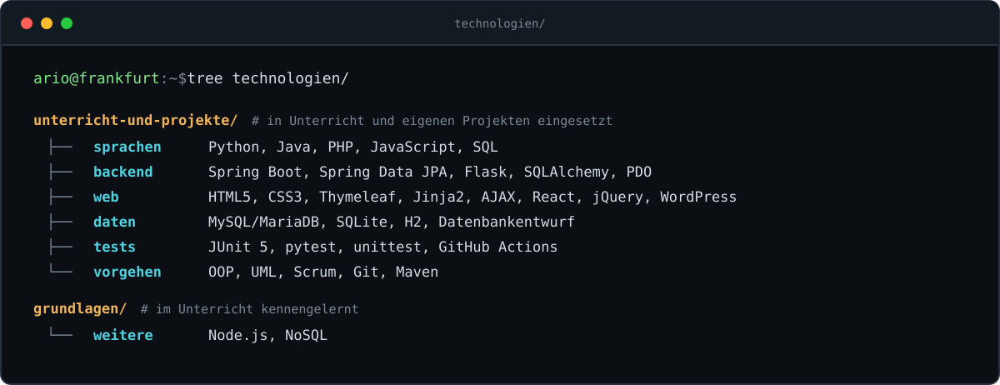

<b>Weitere Unterrichtsinhalte</b>

 

Diese Themen habe ich in der Umschulung kennengelernt, überwiegend auf Grundlagenniveau:

| Bereich | Inhalte |
| :-- | :-- |
| **Systeme und Netzwerk** | Hyper-V sowie Grundlagen zu Windows Server, Active Directory, DNS, DHCP und Netzwerken |
| **Cloud** | Grundlagen zu AWS und Microsoft Azure |
| **Weitere Themen** | Grundlagen zu IT-Sicherheit, künstlicher Intelligenz, Machine Learning und Deep Learning |

 

