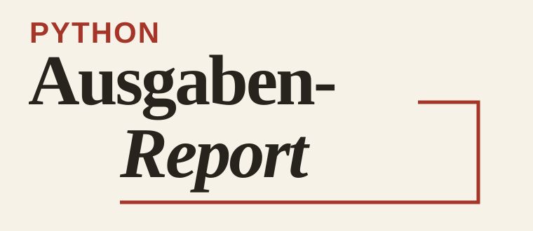

[README.md](https://github.com/user-attachments/files/34963370/README.md)
# Ario

Ich mache bei der CBW eine Umschulung zum Fachinformatiker für Anwendungsentwicklung. Der IHK-Abschluss steht noch aus.

## Projekt

Der **Ausgaben-Report** ist ein Python-Programm für die Kommandozeile. Es liest Ausgaben aus CSV-Dateien ein und fasst sie pro Monat nach Kategorien zusammen. Die Auswertung lässt sich auf einen Monat begrenzen.

Geldbeträge berechnet das Programm exakt mit `Decimal`. Es prüft die Eingaben und meldet Fehler verständlich. Einlesen, Auswertung und Ausgabe sind getrennt. Die Tests laufen mit `unittest`; zusätzliche Pakete sind nicht nötig.

[Quellcode und Tests ansehen](https://github.com/Ario-Mi/ausgaben-report)

## Kenntnisse

**In Unterricht und Übungsprojekten angewendet**  
Python, Java, PHP, JavaScript und React; SQL, relationale Datenbanken und Datenbankentwurf.

**Grundlagen**  
Node.js, NoSQL, Netzwerke, AWS, Microsoft Azure und IT-Sicherheit.

Weitere Unterrichtsinhalte

**In Unterricht und Übungsprojekten angewendet:** HTML5, CSS3, jQuery, WordPress, objektorientierte Programmierung, UML, Scrum und Hyper-V.

**Grundlagen:** Windows Server, Active Directory, DNS, DHCP, KI, Machine Learning und Deep Learning.

## Erworbene Zertifikate

- Professional Scrum Master I (PSM I, Scrum.org)
- AWS Certified Cloud Practitioner
- Oracle Certified Foundations Associate Java
